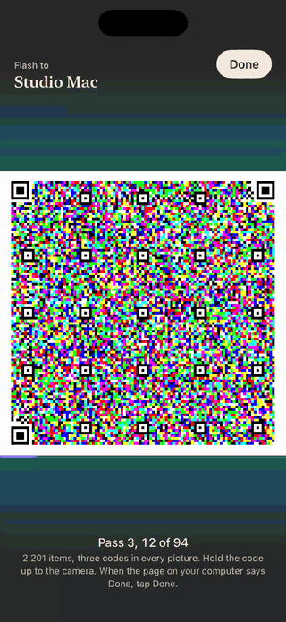
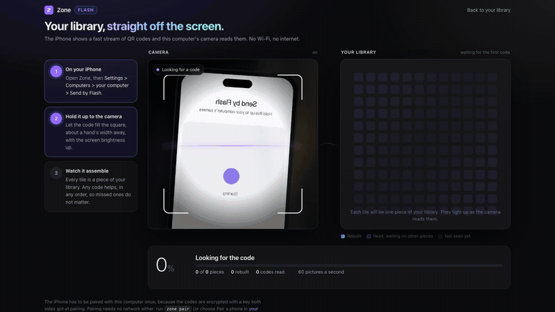

# zone

**Your iPhone dictations, voice notes and meeting transcripts, on your computer and inside your AI agents.**

`zone` is the computer side of [Zone](https://apps.apple.com/app/id6830955448), a free on-device
voice dictation keyboard and app for iPhone. Pair once by scanning a QR code. After that every
dictation, note and meeting transcript lands in a SQLite library on your computer a few seconds
after you make it, over any network, end to end encrypted, with no account and no Zone server.

One small program (about 7 MB, Rust) is all of it: the background service, a command line, an MCP
server for agents, and a local history page.

<p align="center">
  
</p>

- **For your agents:** an MCP server with six tools. `zone install` registers it with every AI client it
  finds: Claude Code (every profile), Codex, Cursor, Hermes, Gemini CLI, Zed, VS Code, Windsurf and a dozen
  more. Then ask "what did I say about the lease on Wednesday afternoon", or "work through my voice notes
  from newest to oldest".
- **For you:** `zone open` for a local history page, and a command line to list, search and export.
- **Three ways in:** Link (automatic, any network), Flash (no network at all: the phone flashes color codes
  at your webcam), and the Zone backup folder in iCloud Drive, OneDrive or Dropbox.

<p align="center">
  
</p>

> **Getting the iPhone side.** Pairing a computer lives in Zone's Settings > Computers (Beta). It is in
> testing and arrives with the next Zone update. Until then, the [backup folder](#the-three-ways-items-arrive)
> works with the Zone version on the App Store today. Every example in this README uses a made-up library.

## Flash: your library, straight off the screen

No Wi-Fi, no internet, no cable. The phone shows a fast stream of codes, three QR codes stacked in the red,
green and blue light of every picture, with a short retro sweep between them. The computer's camera reads
them in a local page and your library assembles itself tile by tile. Every code is encrypted with a key only
your phone and computer share, so filming the screen gets nobody anything. [How it works](#flash-sync-with-no-network).

<p align="center">
  
  &nbsp;
  
</p>

The wire format between phone and computer is in [PROTOCOL.md](PROTOCOL.md).

## What works today, and what does not

| | State |
| --- | --- |
| Link with a real iPhone | Works. A real iPhone 15 Pro paired with a Mac sent a library of 1,764 items in about a second, starting on the relay and moving to a direct connection, and new dictations followed within seconds. Tested on Wi-Fi; cellular and strict company networks are not tested yet. |
| Link across computers | A stand-in phone on a Mac paired with Windows 10 over real iroh: direct, relay only, and found by endpoint id alone. |
| Backup folder import | Works with real Zone backups and synthetic ones. |
| MCP server, command line, web page | Works on macOS; registration checked against the real config files of 20 AI clients. |
| Flash, black and white and color | Tested with pictures and recordings from the iPhone app's own code, and a simulated webcam. **Not yet tested with a real phone held up to a real camera**, so how it copes with glare, blur and distance is still unknown. |
| Clips (text sent from the phone) | The computer's side works and is tested with a stand-in phone. A clip with accents, Japanese and an emoji reached the real clipboard exactly: on a Mac from a zone started by launchd (`pbcopy`), on Windows 10 (`clip.exe`), and on Linux under a virtual X11 display (`xclip`, `xsel`). The iPhone app's side (Settings > Computers > Send text to your computer, a share sheet action and a Shortcut) was tested in the iOS simulator against a real zone: clips arrived in 0.2 to 1.4 seconds. **Not yet sent from a real iPhone.** Wayland's `wl-copy` is written and has not been run. |
| Downloads and one-line installs | `install.sh` installs, updates and refuses a tampered download, tested against a universal Mac archive built the way the release workflow builds it, and in the test suite on macOS and Linux. `install.ps1` passes its test on Windows 10 in Windows PowerShell and PowerShell 7. Release 0.1.0 is published. GitHub's release workflow built all four downloads and ran `install.sh` against them on macOS, Linux x86_64 and Linux arm64 before attaching them. |
| Windows | Built and run on Windows 10: see [Windows](#windows) for exactly what was checked. |
| Linux | The whole test suite passes in a Debian container (arm64), Link over iroh and `install.sh` included. **Not run on a real Linux desktop** yet, so `zone install` (the systemd unit) is untested there. |

## Install

<!-- mac-app -->
Zone for Mac, a menu bar app that brings `zone` with it, is on its way.
<!-- /mac-app -->

Until then, one line installs the command line program. Nothing else is needed: no Rust, no admin rights.

**macOS and Linux**

```sh
curl -fsSL https://raw.githubusercontent.com/zaydiscold/zone-mcp/main/install.sh | sh
```

**Windows** (PowerShell)

```powershell
irm https://raw.githubusercontent.com/zaydiscold/zone-mcp/main/install.ps1 | iex
```

**Homebrew** (soon: the formula is written, the tap is not published yet)

```sh
brew install zaydiscold/zone/zone
```

The script downloads the latest [release](https://github.com/zaydiscold/zone-mcp/releases) for your
computer (one program for both kinds of Mac, a static one for Linux on x86_64 and arm64, an `.exe`
for 64-bit Windows), checks it against the release's `SHA256SUMS`, and puts `zone` in `~/.local/bin`
(on Windows `%LOCALAPPDATA%\Zone\bin`, which it adds to your PATH). It changes nothing else. To read
it first, open [install.sh](install.sh) or [install.ps1](install.ps1). To choose the folder or the
version, set `ZONE_INSTALL_DIR` or `ZONE_VERSION` before running it.

Then:

```sh
zone install     # start zone every time you log in, and register it with the AI clients it finds
zone pair        # show the code to scan with Zone on your iPhone
zone open        # see your transcriptions in the browser
```

`zone install` needs no admin rights: it writes a launchd user agent on macOS, a systemd user unit
on Linux and a per-user Run entry on Windows (`--no-mcp` skips the AI clients). On macOS and
Linux the login item also starts zone again, ten seconds later, if anything but `zone uninstall`
(or the system itself) stops it. `zone doctor` checks the setup and says how to fix anything that
is off. To run zone by hand instead: `zone serve`.

### Updating

```sh
zone update            # is a newer zone out? If so, download it, check it and swap it in
zone update --check    # only say
```

zone never installs an update by itself. `zone update` and `zone doctor` ask GitHub once, when you
run them, which release is the latest, and while the web page is open zone asks at most twice a
day and the page tells you once when a newer one is out (`ZONE_NO_UPDATE_CHECK=1` turns all of
that off). With no page open and no command run, zone asks nobody. An update is
the install script run again: same download, same checksum, and a zone that starts at login is
restarted so the new one is the one running. On macOS and Linux a zone that is running also looks
at its own program file every few seconds, and when another version has taken its place it stops
and starts that one, so a `zone serve` in a terminal does not go on running the old version
(zone 0.1.3 and earlier did, until they were stopped and started). `zone status` names the version
that is running whenever it is not the one on disk. A copy that came from Homebrew, from `cargo install`
or inside Zone for Mac is left alone, and `zone update` says how that copy is updated instead.

If you download an archive from the releases page with a browser on a Mac, macOS will refuse to
open the program, because it is not notarized by Apple. The install script does not have that
problem. For a file you downloaded by hand: `xattr -d com.apple.quarantine ./zone`.

### From source

You need Rust 1.91 or newer.

```sh
cargo install --locked --git https://github.com/zaydiscold/zone-mcp zone
```

or from a checkout:

```sh
git clone https://github.com/zaydiscold/zone-mcp && cd zone-mcp
cargo build --release
cp target/release/zone ~/.local/bin/      # or anywhere on your PATH
```

### Windows

The one-line install above is the short way. To build it yourself you need Rust with the MSVC
toolchain (what `rustup` installs by default on Windows, together with the Visual Studio C++ build
tools). In PowerShell:

```powershell
# in a checkout of this repository
cargo build --release                      # about four minutes the first time
# copy target\release\zone.exe to any folder on your PATH, then:
zone install                               # start at login, no admin rights needed
zone doctor
```

`zone install` writes a small script, `zone-serve.vbs`, into the data folder
(`%LOCALAPPDATA%\Zone`) and adds a per-user entry named `Zone` under
`HKCU\Software\Microsoft\Windows\CurrentVersion\Run` that runs it at login. The script starts
`zone serve` without opening a window. `zone uninstall` removes both and stops zone.

What was checked on a Windows 10 computer (Rust 1.97, MSVC), and what was not:

- Checked: the build (`zone.exe` is about 7.7 MB), the whole test suite (which installs and
  updates with `install.ps1` and puts a clip on the clipboard through a stand-in), `zone status`,
  `zone doctor`, `zone serve`, `zone pair`, `zone stats`, `zone search`, and reading Flash pictures
  with `zone dev flash-decode`.
- Checked across two computers: a stand-in phone on a Mac paired with the Windows computer and sent
  it items, once the normal way (it began on the relay and moved to a direct connection) and once
  forced through the relay only. The counts on Windows matched what was sent.
- Checked: `zone install --no-start` writes the script, and running the script starts zone in the
  background.
- Not checked: the login entry itself (`zone install` without `--no-start`, then logging out and
  in), `zone uninstall`, `zone open` launching a browser, and the Flash page with a Windows camera.

If the web page's usual port (47813) is taken by another program, zone picks a free one and
`zone status` shows which. `zone open` always uses the right one.

## Pair your iPhone

```sh
zone pair
```

This prints a QR code and a `zone://pair?...` link. Scan the code in Zone's Settings > Computers on
the phone. The code works once and expires after ten minutes. In a terminal, `zone pair` then waits
and says so when the phone has paired (Ctrl-C stops the waiting, not the code). The same code is
available in the web page under "Pair a phone".

```sh
zone devices            # paired phones and when each last synced
zone unpair "My iPhone" # forget one (its items stay)
zone resync             # ask the phone to send everything again at its next sync
```

## Send text from your phone

Zone on the iPhone can send a piece of text to your computer on purpose: what is on the phone's
clipboard, something shared from another app, or something you type. It is called a clip. On the
computer, `zone clip` prints the newest one and `zone clip --copy` also puts it on the clipboard.
Run `zone clipboard on` once and a clip lands on this computer's clipboard by itself, a moment
after you send it, ready to paste. This needs the Zone version that has Computers (Beta), and a
paired phone.

```sh
zone clip                # the newest clip: its text and nothing else, so it pipes (zone clip | less)
zone clip --copy         # and put it on this computer's clipboard
zone clip list           # recent clips: when, how it was sent, how long, the first line
zone clipboard on        # from now on, put a clip on the clipboard as it arrives
zone clipboard status    # is that on, and which clipboard tool zone uses
```

With `zone clipboard on`, only a clip that arrives over Link within two minutes of being sent is
copied. An older one (the phone was offline, or it came by Flash) is kept and your clipboard is
left alone, so nothing you sent yesterday replaces what you just copied. It is off until you turn
it on. zone writes the clipboard with what the system has: `pbcopy` on macOS, `clip.exe` on
Windows, and `wl-copy`, `xclip` or `xsel` on Linux (`zone clipboard status` says when none is
there). A clip holds up to 256 kB of text, and is kept in the library like everything else: it
shows in `zone open` with its own label, and agents can ask for it (the newest clip is "the thing
I just sent you"). The exact output for programs is in [docs/clips-cli.md](docs/clips-cli.md).

## The three ways items arrive

All three end in the same merge into the same database, so they can be mixed freely.

1. **Link.** A paired phone connects over [iroh](https://www.iroh.computer) whenever it has something
   new: directly on the same network, by hole punching across networks, or through an iroh relay
   when neither works. Automatic once paired.
2. **Backup folder.** Zone can already keep a backup in iCloud Drive, OneDrive or Dropbox. Point zone
   at it and it re-imports whenever the backup changes. No phone update needed.

   ```sh
   zone backup-folder ~/Library/Mobile\ Documents/com~apple~CloudDocs/Zone\ Backups
   zone import path/to/Zone\ library.zonebackup     # or read one once
   ```
3. **Flash.** The phone shows a fast series of QR codes and the computer's camera reads them. No
   network at all. See the next section.

### When the three disagree

Whatever the phone itself sends, over Link or Flash, wins: it replaces the copy on the computer,
even if the computer's copy looks newer. If you delete something on the phone, the computer keeps
a record that it existed but drops its words, and if you bring it back on the phone it comes back
here too. A backup folder is treated with more care, because a backup can be old: an item from a
backup replaces the computer's copy only when it is at least as new, and a backup never brings
back something you deleted. Things the phone simply stopped keeping because they got old are never
removed here. The computer is the long-term copy.

## Flash: sync with no network

Flash moves your library from the phone's screen to the computer's camera. Use it when the phone
and the computer cannot reach each other at all: a network that blocks everything, a plane, a
computer you keep offline. When Link works, Link is easier, because it is automatic.

1. Run `zone open --flash` (or `zone open` and choose **Flash** at the top of the page).
2. Allow the camera when the browser asks. The pictures never leave your computer: the page hands
   them to zone on the same machine, and nothing is loaded from the internet.
3. On the iPhone, open Zone and choose Settings > Computers > your computer > Send by Flash, and
   hold the screen up to the camera so the code fills most of the square on the page, about a
   hand's width away. Turn the phone's brightness up.
4. Watch your library assemble. Beside the camera is a mosaic with one tile for every piece of
   the library: a tile lights up when its piece arrives, the ones that arrive mixed with others
   wait dimly until the last few codes untangle them, and then everything resolves at once. When
   the page says Assembled, it also says how many items were new, changed, or already here. Then
   tap Done on the phone.

The phone can also flash in color: each picture is three codes at once, one in each of red,
green and blue, so the same pictures carry three times as much. The page reads color pictures
on its own, says "Color Flash: 3 codes a picture" while it does, and undoes the way a camera
blurs the three colors into each other before reading them. The colors need not be the pure
ones: the phone can draw its pictures in a palette of its own, and zone works the palette out
from each picture.

The page guides you as it goes. It says when the camera is not allowed and how to allow it,
suggests moving closer, turning the brightness up or tilting away a glare when it sees no code
for a few seconds, says when a QR code in view is not a Zone flash, and says plainly what to do
when a flash cannot be opened (usually: the phone is not paired, so choose Pair a phone in your
library and scan the code first; zone says this only after more codes have confirmed that none
was misread). While zone puts a large flash together it says so, instead of taking the quiet for
the phone going out of sight.
Everything it shows comes from zone's own decoder, not from an animation.

You do not have to catch every code. Any code helps, in any order, so if the camera misses some
the phone just keeps going until the computer has enough. If you put the phone down early,
nothing is stored and you can start again.

The page keeps count from what the codes themselves carry: how many pieces the flash has, how
many are still needed, how many different codes it caught, and which code numbers it missed
("of codes 1 to 512, the camera missed number 70 and numbers 141 to 143"), so you can see that
nothing slipped by unnoticed and that missing some does not matter. A code misread as another
valid code (rare, but QR error correction cannot rule it out) is found by the other codes,
which have to agree with it, set aside, and the flash finishes without it; the page says so
instead of failing. If the codes never come together (so many misread that the flash cannot be
told apart from them: glare, a dim screen, a phone too far away or moving), zone stops once it
has read the phone's whole loop of codes about twelve times over, and says so, instead of asking
you to keep holding the phone up; choose Start over and try again with the phone steady and
close. When it is done, zone reads every item back from the library and compares
it with what the phone said it sent, count, times to the last binary digit and text: the page
says, for example, "1,764 items, all checked" and the dates they span. The phone shows how many
items and pieces it is sending, and asks you to tap Done only when the page says Done with
that count. Each flash has a name, such as `8f3a 21c4`: the phone shows it under its codes and
in its Done question, and the page shows it too, so you can tell they mean the same flash. One
flash carries up to 4,096 pieces; a larger library goes as several, one after another.

A flash is stored once. If the phone is still showing a flash this computer has stored (you
started over on the page, or zone restarted), the page says it was stored before, and when,
and stores nothing: storing it again would put back older versions of anything sent over Link
since.

The phone has to be paired with the computer first, because the codes are encrypted with a key
both sides get at pairing. Pairing does not need a network either: scanning the code from
`zone pair` (or "Pair a phone" on the page) is enough, and the first flash then completes the
pairing.

How fast: that is up to the phone, which chooses how much each code carries and how many it shows
a second. At 900 bytes a code and 20 codes a second it is about 18 kilobytes of compressed,
encrypted data a second; at 300 bytes and 12 a second, 3.6. Ordinary speech compresses to well
under half its size, so even the slower one is over a thousand words a second. The page sends
every picture the camera takes (up to 1080 pixels square, two at a time) and zone reads one in
about 2.5 milliseconds (a color one in about 17), so the computer keeps up with the camera. In
color, each picture carries three codes, so the same rate moves three times as much. Those
figures come from code sizes and from pictures made to look like a webcam's (`zone dev flash-bench`, and the table in
[PROTOCOL.md](PROTOCOL.md#carrier-2-flash)), not from a stopwatch with a real phone: glare, blur
and distance will cost some codes, so expect it to take longer.

## See your transcriptions

```sh
zone open
```

opens a local page you can work from. Home shows three things side by side: your **notes** as a
list to tick off, your **meetings**, and what you said lately, under a strip of numbers for today
and the week. Every kind has its own color, icon and label, so a note never looks like a dictation.

- **Notes** are a to-do list. Tick one and it is Done; show Open, Done or All, newest or oldest
  first. Done is the same flag an AI agent sets with `mark_processed`, so an agent that works
  through your notes and you ticking them off always agree.
- **Meetings** open to the transcript by speaker, with the time each turn began.
- **History** is everything by day, with search, kinds, where a dictation was spoken, done or not,
  and a calendar. A voice note is listed once: the recording behind it is folded into the note
  (a line says how many are folded, with a way to show them).
- **Statistics**: items, words and time spoken today, this week and over the last 30 days, by kind,
  by hour of the day and day of the week.
- **Phones**: the chip in the bar lists the paired phones by name. Pick one to see only what came
  from it, rename it (every iPhone calls itself "iPhone"), unpair it, or pair another.
- **Export** any item, selection or view as Markdown, plain text, CSV or JSON, to the clipboard or
  a file. Notes alone become a checklist (`- [ ]` open, `- [x]` done), one meeting a transcript
  under a header, anything else a document by day, grouped by kind.
- **Remove** takes an item off this computer only (see below). Nothing on the page can delete
  anything on your iPhone.
- **Settings**: light, dark, this computer's setting or your iPhone's, the accent color (Zone for
  iPhone's five), the clipboard switch, the backup folder, which AI apps are connected and what
  they may see, what you removed, the version and whether a newer one is out, and where the data is.

Press `?` on the page for the keys: `/` search, `g n` notes, `g m` meetings, `j` and `k` to move,
`x` done, `c` copy, `e` export. Every view and filter has its own address
([docs/page-routes.md](docs/page-routes.md)), so `http://127.0.0.1:47813/#/notes` opens the notes.

### Removing something from this computer

Remove hides an item here: on the page, from agents, from the command line and from exports. It
does not touch the phone, and agents cannot do it. A removed item stays away when the phone syncs
again and when a backup is read again. It comes back only if you edit it on the phone (a newer
version is taken as you wanting it), and if you delete it on the phone it is simply deleted. For
30 days you can put it back from Settings, Removed; after that its words are erased from this
computer and only a marker remains, so that it still does not return.

From the terminal:

```sh
zone list --since yesterday
zone list --kind meeting --since 2026-11-01 --until 2026-11-07
zone list --since "2026-11-11 12:00" --until "2026-11-11 17:00" --order oldest
zone search lease renewal --kind dictation --since 30d
zone show 9F1C2E6A            # an id, or the beginning of one
zone stats --by day --since 7d
zone export --format md --since 2026-11-01 -o november.md
zone export --format md --kind note --unprocessed    # open notes, as a checklist
zone export --format csv --kind dictation --phone "Work phone"
zone export --format jsonl > library.jsonl
```

`zone export` writes `jsonl`, `json`, `csv`, `md` or `txt`, `--order oldest` or `newest`, in the
same layouts as the page's Export. `--done` and `--unprocessed` pick items by the done flag,
`--phone` by the phone they came from, and `--id` names single items.

Times can be RFC 3339 (`2026-11-11T12:00:00-08:00`), a date (`2026-11-11`), a date and time
(`"2026-11-11 12:00"`, in the computer's time zone, or the one given with `--tz`), an age (`2h`,
`3d`, `1w`), or `today` / `yesterday`. A bare date as `--until` means through the end of that day.
Output shows local time with the weekday. Add `--json` to any query for scripts.

## See what zone is doing

```sh
zone events                 # what happened lately, newest last
zone events --follow        # and keep printing as things happen
zone events --since 2h
```

```
Sun 2026-11-15 12:00:00  Zone 0.1.1 started
Sun 2026-11-15 12:00:41  My iPhone paired by Link
Sun 2026-11-15 12:00:42  My iPhone synced over Link: 600 new (relay then direct, 1.2 s)
Sun 2026-11-15 12:07:15  My iPhone synced over Link: 2 new, 1 deleted (direct, 0.1 s)
```

The feed holds names and counts only, never your words. It is kept in the library (the newest
2000 events), so it survives a restart and works whether or not zone is running.

### For scripts and apps

Every command that reports something takes `--json`, and those shapes are kept stable: new keys
may be added, existing ones keep their names and meaning.

| Command | What it prints |
| --- | --- |
| `zone status --json` | One object: `now`, `computer`, `daemon` (`running`, `pid`, `version` (of the zone that is running, which after an update can be older than the program), `endpoint_id`, `web_page`, `relay_connected`, `relay_url`), `daemon_running`, `phones`, `last_sync`, `backup_folder`, `backup_folder_state`, `items` (`total`, `by_kind`, `dictations_by_source`, `unprocessed`, `oldest`, `newest`), `data_directory`, `database`. |
| `zone devices --json` | A list, one object per paired phone: `name`, `phone_id`, `endpoint_id`, `app`, `paired_at`, `last_seen`, `last_sync`, `items_received`, `last_path`. Times are Unix seconds. |
| `zone pair --json` | A new code: `id`, `url`, `endpoint_id`, `name`, `expires_at`, `expires_local`, `state` (`waiting`), `claimed` (`false`), `qr_svg` (the code as an SVG picture). With `--wait` it prints that on one line and stays until a phone has used the code or it has run out, then prints a second line: what `--check` prints. |
| `zone pair --check <id> --json` | What became of a code: `id`, `state` (`waiting`, `claimed`, `expired`, or `unknown` once a code that ran out has been forgotten), `claimed`, `expires_at`, `claimed_at`, `device` (`name`, `endpoint_id`, `app`). Exits 0 when claimed, 2 when not. |
| `zone events --json` | The feed, one object per line. See below. |
| `zone mcp status --json` | `zone` (this program), `automatic`, and `clients`: one object per place with `client`, `label`, `profile`, `path`, `installed`, `state` (`registered`, `registered_read_only`, `other_copy`, `not_registered`, `removed_by_you`, `unreadable`), `detail`, and for a place that starts zone (this copy or another) `read_only` and `scope` (`limited`, `kinds`, `exclude_sources`: what its agents can see). |
| `zone doctor --json` | `healthy` and `checks`: a list of `check`, `result` (`ok`, `warn`, `fail`), `detail`, `fix`. Exits 1 when something is broken. |
| `zone list --json`, `zone search --json` | `total` and `items`: `id`, `kind`, `source`, `created_at`, `updated_at`, `created_local`, `text`, `title`, `duration_s`, `words`, `engine`, `status`, `extra`, `rev`, `processed_at`, `carrier`, `device_id`, `received_at`. |
| `zone show --json`, `zone stats --json`, `zone open --print` | A list of items in full, counts by day, kind or source, and the page's link. |
| `zone clip --json` | `clip`: the newest clip (`id`, `source`, `created_at`, `created_local`, `received_at`, `age_s`, `carrier`, `device_id`, `length`, `bytes`, `lines`, `first_line`, `text`), or null when there is none. With `--copy` also `copied`, `tool`, `error`. |
| `zone clip list --json` | `total` and `clips`: the same cards without `text`, newest first. |
| `zone clipboard status --json` (and `on`, `off`) | `clipboard` (`on` or `off`), `enabled`, `available` (a clipboard tool was found), `tool`, `fix`, `max_age_s`, `daemon_running`. |
| `zone update --check --json` | `current`, `latest`, `newer`, `checked` (false when GitHub could not be asked), `page`, `note`, `update_with` (the command that updates this copy). Installs nothing. |

The clip commands are written out in full, with their exit codes, in [docs/clips-cli.md](docs/clips-cli.md).

#### The feed, line by line

`zone events --json` prints one JSON object per line, oldest first. Four fields are on every
line, in this order:

| Field | |
| --- | --- |
| `seq` | A number that only goes up and is never used twice. |
| `at` | When, as Unix seconds. |
| `time` | The same moment as local time, RFC 3339: `2026-11-15T12:00:42-08:00`. |
| `event` | The kind of event. The rest of the line depends on it. |

| `event` | Its other fields |
| --- | --- |
| `daemon_started` | `version`, `pid`, `port` (of the web page) |
| `daemon_stopped` | `uptime_s`. Missing when zone was killed rather than stopped. |
| `relay_connected` | `relay_url` |
| `relay_lost` | none |
| `pair_offered` | `offer` (the code's `id`), `expires_at`, `via` (`cli` or `page`) |
| `paired` | `device` (the phone's name), `device_id`, `via` (`link` or `flash`), `offer` |
| `unpaired` | `device`, `device_id` |
| `link_session` | `device`, `device_id`, `items` (how many the phone sent), `new`, `changed`, `deleted`, `unchanged` (what they did to the library), `rejected`, `frames`, `path` (`direct`, `relay`, or both as `relay then direct`), `duration_s`, `paired` (this session also paired the phone), `end` (`bye`, `closed`, `idle` or `error`) |
| `link_refused` | `device`, `device_id`, `reason` (`not_paired`, `bad_secret`, `version`, `busy`) |
| `flash_received` | `device`, `device_id`, `items`, `new`, `changed`, `deleted`, `unchanged`, `rejected`, `paired`, `bytes`, `color` |
| `flash_failed` | `reason` (a sentence), `bytes` |
| `clip` | A clip arrived: `id`, `device`, `device_id`, `carrier` (`link` or `flash`), `source` (`clipboard`, `share`, `shortcut`, `typed`), `length` (characters), `bytes`, `copied` (it was put on the clipboard), `not_copied` (why not: `off`, `carrier`, `old`, `newer_clip`, `failed`, or null), `tool`. Never the text. |
| `backup_import` | `trigger` (`watch`: zone saw the backup change, or the command: `import`, `backup-folder`), `items`, `new`, `changed`, `unchanged`, `notes`, `dictations`, `meetings`, `skipped` |
| `resync_requested` | `device` (null for every phone), `phones` |

```json
{"seq":5,"at":1794772842.9,"time":"2026-11-15T12:00:42-08:00","event":"link_session","device":"My iPhone","device_id":"7f7f7f7f7f7f7f7f7f7f7f7f7f7f7f7f7f7f7f7f7f7f7f7f7f7f7f7f7f7f7f7f","items":600,"new":600,"changed":0,"deleted":0,"unchanged":0,"rejected":0,"frames":4,"path":"relay then direct","duration_s":1.2,"paired":true,"end":"bye"}
```

`device_id` is the phone's `endpoint_id` in `zone devices --json`. A session is one line, written
when it ends. More kinds and more fields may be added, so skip what you do not know.

`--follow` first prints the newest events (`--limit N`, 50 unless you say otherwise, 0 for none),
then each new one as it happens. `--after SEQ` prints only events numbered above `SEQ`: a program
that restarts passes the last `seq` it saw and misses nothing and repeats nothing. `--since TIME`
takes the same times as `zone list`. On macOS and Linux a follower ends by itself when whatever
was reading it goes away.

## Use it from an AI agent

zone speaks MCP over stdio. `zone install` registers it with every AI client it finds on the
computer, so after that an agent can simply use it. To do it yourself, or again later:

```sh
zone mcp install --all           # every client found here (same as: zone mcp install detected)
zone mcp install claude-code zed # or name them
zone mcp status                  # where it is registered, one line per place
zone mcp uninstall cursor        # take it out of one (zone then leaves that one alone)
zone mcp uninstall --all         # take it out of every one
```

`--all` prints one line per client: registered, already registered, skipped (not installed, or
you took zone out of it) or failed, with the reason. A client counts as installed when its
settings folder exists or its command is on your PATH.

| Client | Name | Where zone writes |
| --- | --- | --- |
| Claude Code | `claude-code` | Every profile: `~/.claude.json`, and `.claude.json` in each `CLAUDE_CONFIG_DIR` folder (`~/.claude*`). Through `claude mcp add --scope user` when the command is there, else by editing the file the same way. |
| Claude Desktop | `claude-desktop` | `claude_desktop_config.json` |
| Codex | `codex` | `config.toml` in `~/.codex`, `CODEX_HOME` and any other `~/.codex*` folder that has one |
| Cursor | `cursor` | `~/.cursor/mcp.json` (the editor and the `cursor-agent` command) |
| Hermes | `hermes` | `~/.hermes/config.yaml` (or `HERMES_HOME`) and every profile's `config.yaml` |
| Gemini CLI | `gemini` | `~/.gemini/settings.json` |
| Qwen Code | `qwen` | `~/.qwen/settings.json` |
| opencode | `opencode` | `~/.config/opencode/opencode.json` |
| Windsurf | `windsurf` | `~/.codeium/windsurf/mcp_config.json` |
| VS Code | `vscode` | The user `mcp.json` (also Insiders when present) |
| Zed | `zed` | `settings.json`, under `context_servers` |
| Kiro | `kiro` | `~/.kiro/settings/mcp.json` |
| Factory Droid | `droid` | `~/.factory/mcp.json` |
| Copilot CLI | `copilot` | `~/.copilot/mcp-config.json` (which VS Code's newer agent also reads) |
| LM Studio | `lm-studio` | `~/.lmstudio/mcp.json` |
| Goose | `goose` | `~/.config/goose/config.yaml`, under `extensions` |
| Crush | `crush` | `~/.config/crush/crush.json` |
| Amp | `amp` | `~/.config/amp/settings.json` |
| Cline | `cline` | `~/.cline/data/settings/cline_mcp_settings.json` (and the older VS Code extension's file) |
| Roo Code | `roo` | The VS Code extension's `mcp_settings.json` |

Paths are the macOS and Linux ones; on Windows each client's own folder is used. Registering with
every profile of Claude Code, Codex and Hermes is also what makes zone available in apps that run
those agents with their own profiles, such as T3 Code.

Only the `zone` entry is added, changed or removed. Everything else in those files stays exactly as
it was, comments included (Zed, VS Code and Hermes keep comments in their settings), a link to a
file kept elsewhere stays a link, and a copy of the original is saved beside it as
`<file>.before-zone` the first time. Add `--read-only` to register a server that cannot flag
items. For any other client, the command to run is `/path/to/zone mcp`.

The server opens the database itself, so it works whether or not `zone serve` is running.

### Choosing what an agent can see

By default an agent with zone registered can read the whole library. Most of a library is
dictations typed by voice into other apps, which means messages you sent to people. You can show
a client less:

```sh
zone mcp install claude-desktop --notes-only           # only your voice notes
zone mcp install cursor --kinds note,meeting           # notes and meeting transcripts, no dictations
zone mcp install codex --no-keyboard                   # everything except what you typed into other apps
zone mcp install --all --no-keyboard                   # the same, for every client
zone mcp install --all --kinds all                     # back to everything, for every client
zone mcp status                                        # says what each client sees
```

| Flag | What the client's agents see |
| --- | --- |
| `--kinds <list>` | Only these kinds: `dictation`, `note`, `meeting`, `clip` (comma separated), or `all`. |
| `--exclude-sources <list>` | Not the dictations spoken in these places: `keyboard` (typed by voice in other apps), `app` (dictated inside Zone), `note` (the raw dictation behind a voice note). A clip's source works the same way: `clipboard`, `share`, `shortcut`, `typed`. |
| `--notes-only` | Short for `--kinds note`: no dictations, no meetings, no clips. |
| `--no-keyboard` | Short for `--exclude-sources keyboard`. |
| `--read-only` | Everything it would otherwise see, but it cannot flag items as processed. |
| `--read-write` | Undoes `--read-only` on a client that has it. |

The flags work on `zone mcp` itself too, which is what the client ends up running
(`zone mcp --kinds note,meeting`). The limit holds in every tool: a hidden item is not listed,
not found by search, not returned by its id, and not counted, and the server tells the agent that
its view is limited so it does not mistake what it sees for everything.

Running an install line again never shows an agent more than it saw before. A client that
already has a limited view keeps it until you name another (`--kinds all` is everything), and one
that is read-only stays read-only until you give `--read-write`, also when the install points it
from another copy of zone to this one. `zone mcp install --all` without
a view flag leaves every client's view as it is. A mistyped kind is an error, never "everything".

Clips (text you sent from the phone on purpose) are a kind of their own, so a client limited to
some kinds sees them only when `clip` is one of them: `--kinds note,meeting` and `--notes-only`
leave clips out, and `--kinds clip` shows an agent what you send it and nothing you said.

### Staying registered

`zone install` turns on one more thing: when zone starts, it registers with clients installed
since. It only ever adds zone to a client that never had it. It never changes an entry that is
there, and it never puts zone back where you took it out, whether with `zone mcp uninstall` or
by deleting the entry by hand. It does this only when it is the same `zone` program that
`zone install` was run from. `zone install --no-mcp` skips all of it, and `zone uninstall` or
`zone mcp uninstall --all` turns it off. What zone has registered, and where you took it out, is
kept in `mcp-clients.json` in the data folder.

`zone doctor` names any installed client that does not have zone yet and gives the one command
that fixes it.

### The tools

Deliberately few.

| Tool | What it does |
| --- | --- |
| `list_items(start?, end?, kinds?, sources?, order?, limit?, cursor?, unprocessed_only?, timezone?)` | Short cards for a time range (id, kind, source, local time with weekday and UTC offset, duration, word count, first 200 characters, processed flag), the total that match, counts by kind, and a cursor for the next page. |
| `search_items(query, start?, end?, kinds?, sources?, limit?, cursor?, timezone?)` | Full-text search with snippets around the matches, best match first, with a cursor for the next page. |
| `get_items(ids, max_chars?, offset?, timezone?)` | Full text, bounded, with a `truncated` flag and `next_offset`. |
| `library_stats(start?, end?, group_by?, kinds?, sources?, timezone?)` | Counts, words and recorded seconds by local day, kind or source. |
| `sync_status()` | The computer's current local time, weekday and time zone (so an agent can resolve "Wednesday"), paired phones, last sync per carrier, counts. |
| `mark_processed(ids, processed?)` | The only write. Sets or clears a flag so an agent can work through items once. It never changes an item's text. Hidden by `--read-only`. |

The four kinds of item:

- `dictation`: something dictated. Most have source `keyboard`: messages and text typed by voice in
  other apps. Source `app` was dictated inside Zone; source `note` is the raw dictation behind a
  voice note.
- `note`: a voice note saved in Zone.
- `meeting`: a meeting transcript, one `Speaker: words` line per turn, with a title.
- `clip`: text sent to this computer on purpose from the phone (see [Send text from your
  phone](#send-text-from-your-phone)), with source `clipboard`, `share`, `shortcut` or `typed`.
  Exact text, not speech. The newest clip is "the thing I just sent you".

## Privacy

- **Your computer keeps a local copy.** It lives in one SQLite file in the data folder below, readable
  only by your user. Nothing is uploaded anywhere by zone.
- **Phone and computer talk directly.** The connection is end to end encrypted between two keys:
  the phone's and the computer's. When a direct path is not possible it goes through an iroh relay,
  which forwards encrypted packets and stores nothing. Finding the computer from its id uses iroh's
  public address lookup, which publishes how to reach the endpoint (its relay), not what it holds.
- **No account, no Zone server.** Pairing is a one-use secret in a QR code. After that the computer
  accepts only the phones it has paired with, by their keys.
- **The web page is local.** It listens on 127.0.0.1 only, needs a random key that `zone open`
  passes to your browser, refuses requests under any other host name, and loads nothing from the
  internet. Everything it can change (done, remove, a phone's name, unpairing, its settings) is a
  POST that needs that key and is refused when it comes from any other site. While the page is
  open, zone itself asks GitHub whether a newer zone is out, at most twice a day, as `zone update
  --check` does, and the page says so once per version (`ZONE_NO_UPDATE_CHECK=1` turns that off).
- **Agents read what you let them, and what they read leaves your computer.** An MCP client that
  has zone registered can read the whole library unless you narrow it: `zone mcp install <client>
  --notes-only`, `--kinds note,meeting` or `--no-keyboard` (see [Choosing what an agent can
  see](#choosing-what-an-agent-can-see)). Whatever an agent does read is sent to the company that
  runs its model, as part of the conversation, under that company's terms, not zone's. The one
  thing an agent can change is the processed flag (Done on the page). An item you removed on the
  page is not shown to any agent. The limit is on what zone hands to an agent: it
  does not stop another program running as you from opening the library file itself.
- **Flash stays in the room.** The camera pictures go from the browser to zone on the same
  computer and are thrown away once read. What the phone shows is encrypted, so someone filming
  the screen gets nothing they can open.
- **Logs never contain your words.** `zone.log` and the feed (`zone events`) record what happened,
  with names and counts only. For a clip that is its length and how it was sent, never its text.
- **Your clipboard is yours.** zone writes this computer's clipboard only after `zone clipboard on`
  or `zone clip --copy`, and never reads it. What is on the phone's clipboard leaves the phone
  only when you send it.

One limit worth knowing: the page's key is kept in a cookie for `127.0.0.1`, and browsers do not
separate cookies by port. Another program serving pages on `127.0.0.1` could be sent that cookie if
you visit it in the same browser.

## Where things live

| | Data folder |
| --- | --- |
| macOS | `~/Library/Application Support/Zone` |
| Windows | `%LOCALAPPDATA%\Zone` |
| Linux | `$XDG_DATA_HOME/zone` or `~/.local/share/zone` |

Set `ZONE_HOME` to use another folder. Inside it: `zone.db` (the library), `endpoint.key` (this
computer's iroh identity), `web.token` (the web page's key), `zone.log`, `mcp-clients.json` (which
AI clients zone registered with, and which you took it out of), and `daemon.json` while zone is
running.

Other settings, all optional: `ZONE_PORT` (web page port, default 47813), `ZONE_NAME` (the name
shown to the phone), `ZONE_RELAY_URL` (use your own iroh relay instead of the public ones; it is
then included in the pairing link), `ZONE_CLIPBOARD_COMMAND` (a command that gets a clip's text on
its standard input, used instead of the system's clipboard tool), `ZONE_NO_UPDATE_CHECK=1` (never
ask GitHub whether a newer zone is out).

## Uninstall

```sh
zone mcp uninstall --all          # takes zone out of every AI client
zone uninstall                    # stops zone and removes the login item
```

Your library stays in the data folder. Delete that folder to remove it, then delete the `zone`
program (`~/.local/bin/zone`, or the `Zone\bin` folder under `%LOCALAPPDATA%` on Windows).

## Development

```sh
cargo test                        # unit tests and end-to-end tests, all offline
cargo test -- --ignored           # also the tests that use iroh's public relays (needs internet)
ZONE_HOME=$(mktemp -d) scripts/mcp_roundtrip.py --zone target/release/zone
```

Every test runs in a temporary `ZONE_HOME` and a temporary home folder. A hidden test peer,
`zone dev fake-phone`, plays the phone's side of Link over real iroh: it pairs with a link or
reconnects with a saved identity, sends synthetic items or a JSONL file in frames, and prints the
acks. `--relay-only` removes its IP transports so every packet goes through the relay.

To look at the page without your own library, fill a throwaway one: `zone dev synthetic --demo
--count 400 > demo.jsonl` writes a made-up library that reads like a real one (notes to tick off,
meetings with several speakers, clips, voice notes with their recordings), and `zone dev fake-phone
--file demo.jsonl` sends it. `--appearance` and `--accent` make the fake phone say how Zone looks
on it. Run both with `ZONE_HOME` set to an empty folder and `zone serve --port` on another port.

Flash can be tested without a phone or a camera. `zone dev flash-encode` draws the codes a phone
would show as numbered PNG pictures, and `zone dev flash-decode` reads a folder of such pictures
back, whatever the files are called and whatever size the codes are drawn at:

```sh
zone dev flash-encode --out /tmp/frames --secret <64 hex characters> --count 200
zone dev flash-decode /tmp/frames --secret <the same 64 hex characters>            # prints counts only
ZONE_HOME=$(mktemp -d) zone dev flash-decode /tmp/frames --secret <...> --import   # also stores the items
```

Without `--secret`, flash-decode tries the keys of the phones paired with this library, the way
the page does. `scripts/flash_reference.py` is the reference for how the codes are made.

`--color` draws color pictures instead, three frames to a picture, and flash-decode reads them
just the same. `--levels r0,r1,g0,g1,b0,b1` draws them in a palette: the dark then the light level
of red, green and blue (`--levels 60,255,0,200,90,255`), the way the phone can for a designed look.
The reader is never told the palette: it works it out from each picture. `zone dev flash-read
<folder>` prints the codes found in each picture, as hexadecimal (flash frames are encrypted, so
this shows no words).

`zone dev flash-bench` times the page's QR reader on pictures made to look like a webcam's: a
code of the chosen size, scaled to a given width, turned, blurred and noisy (and with `--color`,
the three channels leaking into each other and color stored at half resolution, as webcams do).
It prints the read time and how many codes were read:

```sh
zone dev flash-bench --chunk 900 --code-px 450                   # 900 byte codes, 450 pixels wide
zone dev flash-bench --chunk 700 --tilt 10 --blur 2 --noise 10   # a harder picture
zone dev flash-bench --color --crosstalk 0.3 --code-px 550 --picture 770   # color Flash
zone dev flash-bench --chunk 900 --sample /tmp/look.png          # and save one picture to look at
zone dev flash-bench --color --camera harsh --levels 60,255,0,200,90,255 --code-px 550 --picture 770
zone dev flash-sweep --table                                     # the palette table in PROTOCOL.md
```

`--camera normal`, `harsh` or `blurred` picks one of the made-up cameras the tables in
[PROTOCOL.md](PROTOCOL.md#the-palette) are measured with. `zone dev flash-sweep` reads color
pictures for each contrast span (`--spans 255,200,170,150,120`), code width (`--widths
450,550,700`) and camera (`--cameras normal,harsh`), and prints how many codes were read in each.

A clip can be sent without a phone too: `zone dev fake-phone --identity phone.json --addr
127.0.0.1:PORT --clip "some text"` sends one as if it had just been sent (`--clip-age 600` makes it
ten minutes old, `--clip-source share` says how it was sent). Tests set `ZONE_CLIPBOARD_COMMAND` to
a command that writes a file, so no test touches the real clipboard.

### Releases

Every push runs the tests and the linter on macOS, Linux and Windows
([ci.yml](.github/workflows/ci.yml)). Pushing a tag builds a release
([release.yml](.github/workflows/release.yml)):

```sh
# set version in Cargo.toml (and Cargo.lock: cargo build does it), commit, then:
git tag v0.2.0 && git push origin v0.2.0
```

The tag must match the version in `Cargo.toml`. The workflow builds a universal program for
macOS, static programs for Linux on x86_64 and arm64, and `zone.exe` for Windows, runs
`install.sh` against what it built, and attaches the archives, `SHA256SUMS` and a filled-in
Homebrew formula to a draft release. Nothing is public until you publish the draft on GitHub.
The install scripts and `zone update` find a release only once it is published and is the latest.
The formula template is [packaging/homebrew/zone.rb](packaging/homebrew/zone.rb): its header says
how to make the tap.

iroh is pinned to the 1.4 line, the same one the phone's Swift binding (`iroh-ffi` 1.2.0) uses.
Endpoint ids are written the way iroh 1.x prints them: 64 lowercase hexadecimal characters.

## License

MIT. See [LICENSE](LICENSE).
