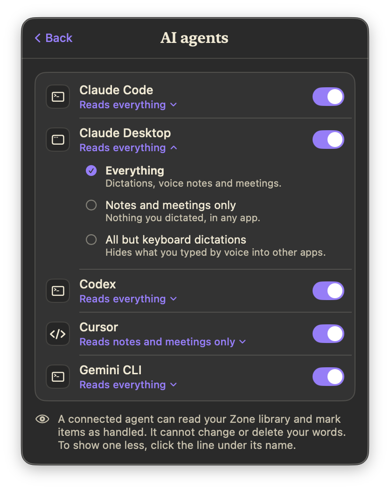
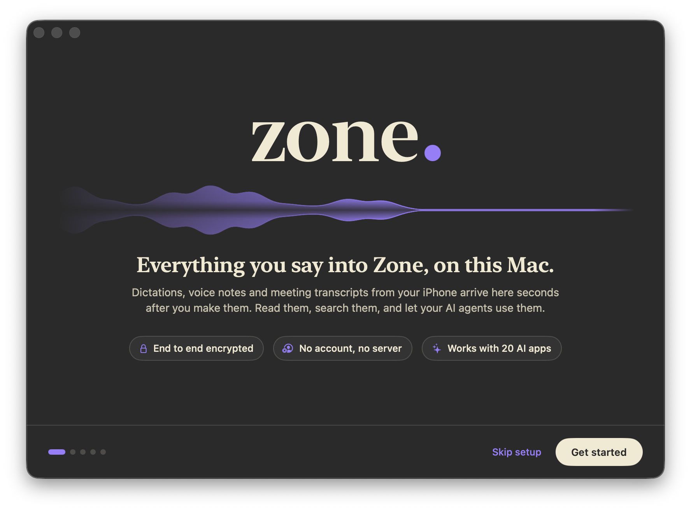

# Zone for Mac

A menu bar app that is the whole install of [zone](../README.md) on a Mac. Download one app,
open it, scan one code with your iPhone. No terminal.

<p align="center">
  
</p>

It carries the `zone` program inside it and runs it for you. Everything zone does (receive
your iPhone's dictations, notes and meeting transcripts, keep them in a library on this Mac,
serve them to your AI agents) works the same as from the command line. The app adds what a
command line cannot: a Z in the menu bar that says at a glance whether zone is running, a
window that shows what just arrived, and a first-run guide.

Everything pictured here is a made-up library.

## What you get

**The Z in the menu bar.** A serif Z with a dot, the mark of the iPhone app. A steady dot:
running. A pulsing dot with a ring: something is arriving right now. A faded Z with a hollow
dot: zone is not running. An exclamation mark: something needs you.

<p align="center">
  
</p>

**Click it.**

- Each paired phone: when it last synced, how many items it has sent, and whether the last
  sync went directly or through the relay.
- Whether this Mac can be reached from other networks.
- How many things you said today, how many are in the library, and how they split into
  dictations, notes and meetings.
- What just happened: "3 dictations from Demo iPhone, just now".
- The latest items. Click one to copy it. **Hide text** covers the words, for when you are
  sharing your screen (it stays on until you turn it off, here and in the floating window).
- Agents: every AI app on this Mac with a switch, and under each connected one a line
  that says what it may read. Click the line to choose: everything, notes and meetings
  only, or all but keyboard dictations (what you typed by voice into other apps).
- Pair, History, Flash, and More: ask the phone to resend everything, choose a
  backup folder, start at login, the `zone` command, who runs zone, updates, the setup guide.

<p align="center">
  
  &nbsp;
  
</p>
<p align="center">
  
</p>

**The floating window.** "Keep these in a floating window" opens a small window that stays
above your other windows and shows what you said as it arrives, with a search over the
whole library and filters for dictations, notes and meetings. Clicking a row copies it
without taking the keyboard away from the app you are working in.

<p align="center">
  
</p>

**The setup guide**, the first time you open the app (and any time later, under More):
welcome, get Zone on your iPhone, pair, connect your AI agents, done. Every step can be
skipped, and closing the window half way keeps your place.

<p align="center">
  
</p>
<p align="center">
  
</p>

## Install

1. Open `Zone.dmg` and drag Zone to Applications.
2. Open Zone. The guide walks through the rest.

Pairing with a computer arrives with Zone's next iPhone update (Settings > Computers). Until
then, the backup folder works with the Zone on the App Store today: More > Backup folder.

To remove it: quit Zone (that stops zone too), turn off "Start Zone when you log in" first if
it was on, and delete the app. Your library stays in `~/Library/Application Support/Zone`.
The AI clients you connected keep working, because they start the copy of zone in that
folder, not the app. Disconnect them under Agents before deleting the app if you want them
gone.

## How it runs zone

The app owns the background service.

- **When nothing is running**, the app starts `zone serve` and keeps it alive: if it stops by
  itself it is started again (after 1, 2, 5, 15, then 60 seconds, so a zone that cannot start
  does not spin). Quitting the app stops it. "Start Zone when you log in" registers the app
  itself as a login item (`SMAppService`), so there is one thing to turn on or off.
- **When a zone is already running**, the app attaches to it and never starts a second one
  (zone itself refuses a second, with a lock on its data folder). It works out whose it is:
  - the app's own copy, left running because the app was force quit: adopted, and stopped
    when you quit as usual;
  - started at login by `zone install` (the launchd agent `wtf.zayd.zone.link`): left
    alone. The app shows a note with two choices, "Let this app run zone" (runs
    `zone uninstall`, which removes that login item, then starts its own) or "Keep it this
    way" (it is not asked again; the choice stays under More > Who runs zone);
  - started some other way, most likely `zone serve` in a terminal: the same note, and
    taking over stops that process.
- **The app's own copy of zone** lives at `~/Library/Application Support/Zone/bin/zone`. On
  every launch the app makes sure it is the same program as the one inside the app, and
  replaces it when the app was updated. It is never written into while it runs: the new file
  is written beside it and moved into place (macOS kills a signed program whose file changes
  under it). This is the path AI clients are registered with and the `zone` command links
  to, so they survive the app being updated, moved, or opened straight from the disk image.
- **AI clients** are connected by running `zone mcp install <client>` from that copy, one
  switch per client (every profile of it). A client that already starts another zone (one
  installed from the command line) is shown as connected, with a button to point it at this
  app's.
- **What a client may read** is zone's own limit (`zone mcp install --kinds ...
  --exclude-sources ...`): the app writes "notes and meetings only" as `--kinds note,meeting`
  and "all but keyboard dictations" as `--exclude-sources keyboard` into that client's
  entry, and zone then never lists, searches or returns anything outside it to that client.
  A view or `--read-only` set from the command line is shown as it is and kept: whenever
  the app registers a client again it repeats the flags the client already has, because a
  plain `zone mcp install` would put it back to everything.
- **The `zone` command** is offered, never forced: More > zone in the terminal. It is a link
  in the first writable folder on your PATH out of `~/.local/bin`, `~/bin`,
  `/opt/homebrew/bin` and `/usr/local/bin` (the last one asks for your password when it has
  to). If another `zone` is already on your PATH, the app says where and leaves it alone
  unless you choose to replace it.
- **What just happened** comes from `zone events --json --follow` (and if that follower ever
  ends, it is started again with `--after` the last event seen, so nothing is missed or
  shown twice). When the app is attached to an older zone that does not write events down,
  it reads `zone.log` instead. Both sit behind one small protocol, `ActivitySource`, and
  the app changes from one to the other by itself (after taking over, for example).
- **Pairing** shows the code from `zone pair --json`, and knows it worked when the `paired`
  event names that very code (or, with an older zone, when a new phone appears in
  `zone devices`).

Inside the app the program is at `Zone.app/Contents/Helpers/zone`, not in `Contents/MacOS`:
on a Mac's usual disk, which ignores case in file names, `zone` there would be the same file
as the app's own program, `Zone`.

## Build it

You need Xcode 15 or newer, [XcodeGen](https://github.com/yonaskolb/XcodeGen)
(`brew install xcodegen`), and Rust 1.91 or newer.

```sh
mac/scripts/build-app.sh
```

It builds the universal `zone` (Apple silicon and Intel, adding the Rust target if it is
missing), builds the app, puts zone inside it, signs both, and makes `mac/build/Zone.dmg`
with the drag to Applications layout. `--help` lists the options: `--identity`, `--notarize`,
`--zone-binary`, `--committed`, `--no-dmg`, `--version`.

### Signing, and who can open the result

| Signed with | Who can open it |
| --- | --- |
| Developer ID Application, notarized | Anyone, with a double click |
| Apple Development | This Mac (and Macs registered to the team) |
| ad hoc (`--identity -`) | This Mac only |

The script uses a Developer ID Application identity when the keychain has one, and says
which it used. To share the app with other people:

1. The Account Holder of the developer team makes the certificate once. Apple does not let
   an API key or any other role do it. In Xcode: Settings > Accounts > the team > Manage
   Certificates > + > Developer ID Application.
2. `mac/scripts/build-app.sh --notarize`

Notarizing uses `asc notarization` when [asc](https://github.com/rorkai/App-Store-Connect-CLI)
is installed and signed in. Otherwise set `NOTARY_KEY` (the `.p8` file), `NOTARY_KEY_ID` and
`NOTARY_ISSUER`, or `NOTARY_PROFILE` (a notarytool keychain profile).

## Work on it

```sh
cd mac/ZoneKit && swift test        # the logic: parsing, who runs zone, the event feed
mac/scripts/dev-build.sh            # a quick debug build for this Mac
mac/scripts/dev-sandbox.sh start    # run it without touching anything real
```

`dev-sandbox.sh` runs the app with `ZONE_MAC_SANDBOX` set to a folder (`/tmp/zone-mac-sandbox`).
Everything then stays inside that folder: a pretend home folder with a few pretend AI
clients in it, a made-up library, another port (47991). The installed zone, its login item,
the real library and real AI client settings are never read or written. In that mode the
app also never adds a real login item, never looks at launchd, never asks for a password,
and a pretend `open` notes links in a file instead of starting the browser.

A sandbox run stays out of the way of whoever is using the Mac: its windows never take the
keyboard and sit all but three points beyond the right edge of the screen, where macOS still
draws them. It is steered by writing lines to a file, and photographs its own windows:

```sh
mac/scripts/dev-sandbox.sh start --fresh --show welcome:2   # the pairing step
mac/scripts/dev-sandbox.sh phone 180        # a stand-in phone scans the code on screen and sends 180 items
mac/scripts/dev-sandbox.sh send 3           # three more, a moment later
mac/scripts/dev-sandbox.sh cmd popover "snap:popover=/tmp/popover.png"
mac/scripts/dev-sandbox.sh cmd "click:popover=314,328"      # a click, in points from the window's top left
mac/scripts/dev-sandbox.sh stop
```

The stand-in phone is `zone dev fake-phone`: it pairs with the very code the app is showing
and sends items over real iroh. The commands are listed in `Zone/ZoneApp.swift`
(`run(command:)`). `--front` shows the windows on screen like a normal run. Every picture in
this file was taken this way.

### Where things are

| | |
| --- | --- |
| `ZoneKit/` | A Swift package with everything that is not a view, and its tests: what zone prints as Swift values (`Models`, `Agents`), running zone (`ZoneClient`), the event feed (`Events`, `ActivitySources`), who runs the service and the app's copy of zone (`Daemon`), the `zone` command and update check (`CommandLink`), where files are (`ZoneEnvironment`). |
| `Zone/AppModel.swift` | The one object the views read and call. |
| `Zone/StatusItemController.swift`, `MenuBarIcon.swift` | The Z and the window under it. |
| `Zone/PopoverView.swift`, `SharedPanels.swift` | The popover's pages, and the pairing and agents panels the guide also uses. |
| `Zone/WelcomeView.swift`, `FloatingView.swift` | The guide and the floating window. |
| `Zone/Theme.swift`, `Wave.swift`, `QRCode.swift` | The look, taken from the iPhone app: warm paper and ink, one purple accent, a serif wordmark, hard-edged shadows, the flowing wave. |
| `project.yml` | The Xcode project, generated with `xcodegen generate`. |
| `scripts/` | `build-app.sh`, `build-zone-binary.sh`, the sandbox scripts, and the two that draw the app icon and the disk image background. |
| `dmg/` | The disk image's layout and background. |

## Not done yet

- The app has not been run outside the sandbox, so four things are written but not
  exercised: registering the real login item, taking over from a real `zone install` login
  item, the administrator prompt for `/usr/local/bin`, and the folder chooser for the
  backup folder (watching a folder was exercised, choosing one in the system window was not).
- Pairing was exercised with zone's stand-in phone, not with a real iPhone.
- Updates are a check against the latest GitHub release and a link to it. The app does not
  update itself.
- The disk image has not been opened on a second Mac, and no Developer ID build exists yet
  (see above).
