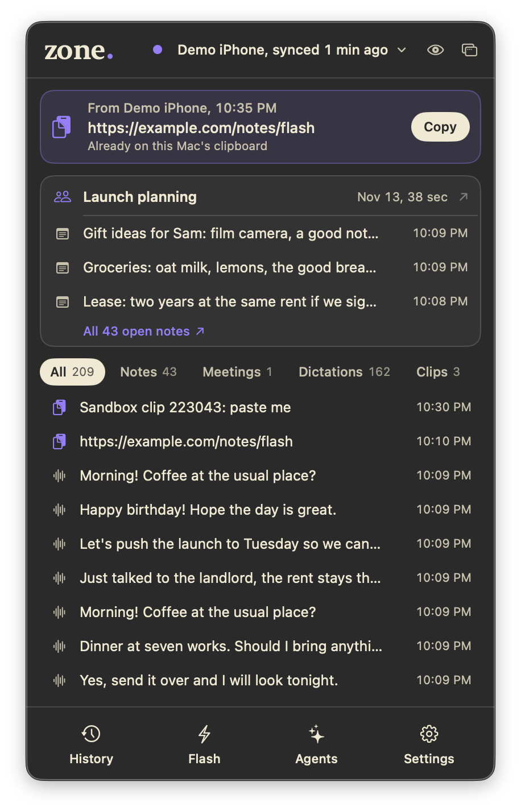
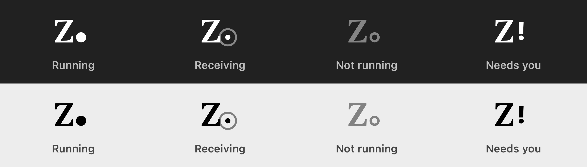
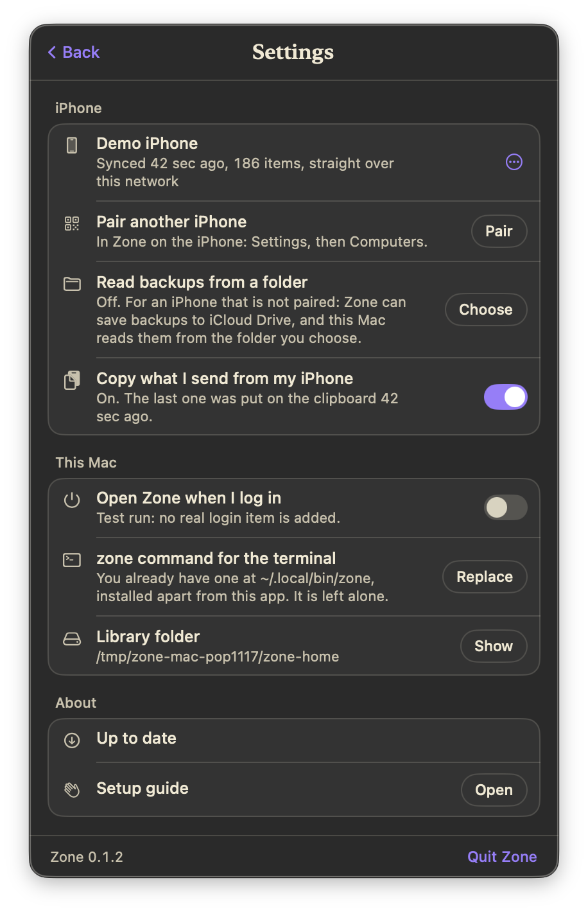
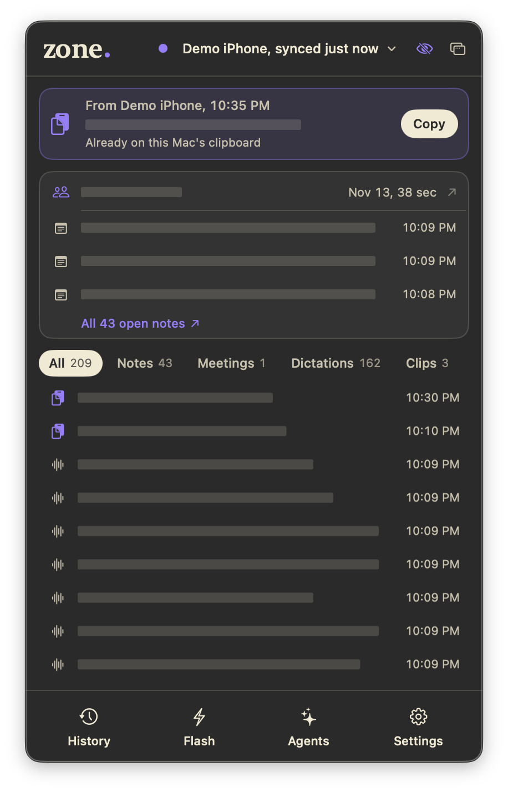
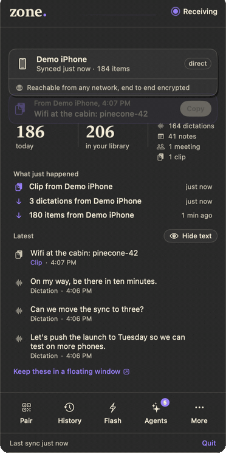

# Zone for Mac

A menu bar app that is the whole install of [zone](../README.md) on a Mac. Download one app,
open it, scan one code with your iPhone. No terminal.

<p align="center">
  
</p>

It carries the `zone` program inside it and runs it for you. Everything zone does (receive
your iPhone's dictations, notes and meeting transcripts, keep them in a library on this Mac,
serve them to your AI agents) works the same as from the command line. The app adds what a
command line cannot: a Z in the menu bar that says at a glance whether zone is running, a
window that shows what just arrived, and a first-run guide.

Everything pictured here is a made-up library.

## What you get

**The Z in the menu bar.** A serif Z with a dot, the mark of the iPhone app. A steady dot:
running. A pulsing dot with a ring: something is arriving right now. A faded Z with a hollow
dot: zone is not running. An exclamation mark: something needs you.

<p align="center">
  
</p>

**Click it.** The window is a place to work from, and says each thing once.

- One line at the top: which phone synced last and when ("Demo iPhone, synced 2 min ago"),
  "Receiving" while something arrives. Click it for the rest: how the last sync travelled,
  what the library holds, and the last few things that happened (a clip that zone put on the
  clipboard says ", copied"). Beside it, the eye (**Hide text**) covers the words for when
  you are sharing your screen (it stays on until you turn it off, here and in the floating
  window), and the window icon opens the floating window.
- The newest clip, for a quarter of an hour after it arrives (see Clips below).
- Your last meeting: its title, when, how long. Click it and its transcript opens in History.
- The newest three notes nobody has marked Done (on the history page, or an agent with
  `mark_processed`), and a link to all of them in History.
- The latest things you said, nine to twelve rows at a time and more on a scroll. Above them
  All, Notes, Meetings, Dictations and Clips, each with how many the library holds: click one
  to see only that kind. A row is one line with an icon for its kind; click it to copy, and
  the time gives way to "Copied". What already has a place above (the clip, the meeting, the
  three notes) is not listed a second time under All.
- History, Flash, Agents and Settings.
- Only when something needs you, a line at the top says what: no iPhone paired yet
  (**Pair**), something macOS has to allow (**Allow**, see below), or zone that keeps
  stopping (**Start again**, **Show the log**).

**History, in a Zone window.** zone's history page, served by zone on this Mac, opens in a
window of the app (**Open in browser** shows it in the browser instead). That is what lets
the menu open it at a place: a meeting (`#/meeting/<id>`), the notes (`#/notes`). The links
are made in one function, `PageRoutes` in `ZoneKit/Menu.swift`.

**Agents.** Every AI app on this Mac once, however many profiles it has ("Claude Code: 7
profiles, reads everything"), with a switch. Click its name for each profile as `zone mcp
status` reports it: connected, starts another copy of zone, removed by you, not connected.
Click the line under its name to choose what it may read: everything, notes and meetings
only, or all but keyboard dictations (what you typed by voice into other apps). The apps
that are not connected fold under one line.

**Test** does not take zone's word for it. It reads from the app's own settings file which
program and arguments that app would start (`AgentConfig`: JSON with or without comments,
Codex's TOML, Hermes's YAML), starts exactly that with nothing of zone's in the environment,
and asks it what every MCP client asks first (`initialize`, then `tools/list`). The answer
is "Answers: 6 tools", or what went wrong in zone's own words. "zone on this Mac" at the
foot is the same check with no app in between.

An app whose entry starts a different copy of zone than the one that runs on this Mac says
so, with **Use this one**: that is `zone mcp install <app>`, which points it at the running
one and keeps what it may read. The zone that "runs on this Mac" is this app's own copy,
unless a login item from the command line runs zone: then it is that program, so the panel
says what `zone mcp status` says in a terminal.

**Settings.** Each paired phone (when it last synced, how many items, and a menu to ask it to
send everything again or forget it), pairing another, reading backups from a folder, copying
what you send from the iPhone, opening Zone at login, the `zone` command, the library
folder, updates, the setup guide, and Quit. The version is at the foot, once. Updates are
one line: "Up to date", or "0.1.3 is available" with **Update** (which opens the download
page), or "Could not check for updates" with **Try again**. A build that is newer than the
latest published release is up to date. When GitHub's API is at its hourly limit for the
network, the app asks GitHub's website instead.

<p align="center">
  
  &nbsp;
  
</p>
<p align="center">
  
</p>

**Clips.** A clip is text you send from Zone on your iPhone to this Mac on purpose: what
was on the phone's clipboard, something shared from another app, or something typed. When
one arrives the Z pulses the way it does for anything arriving, and the clip leads the
window: which phone, when, one line of it, and a Copy button. Clips also sit in the latest
items with their own icon and their own kind above the list (the one in the card is not
listed twice), and the floating window has a filter for them. Hide text covers a clip like
everything else.

<p align="center">
  
</p>

Settings > "Copy what I send from my iPhone" is `zone clipboard on`: with it on, a clip that
was sent in the last two minutes is ready to paste here by the time you look up. The switch
shows what zone itself reports, and once it is on the line under it says how to try it, and
after that when the last clip was put on the clipboard (or that it could not be). It is off
until you turn it on (the setup guide asks once), and nothing else ever touches your
clipboard. The app shows no notification and asks for no permission. This was run end to
end on 2026-11-17 with a throwaway zone under a throwaway launchd agent, the way the login
item runs: a clip from the stand-in phone came back from `pbpaste`.

**The floating window.** The window icon at the top of the menu opens a small window that stays
above your other windows and shows what you said as it arrives, with a search over the
whole library and filters for dictations, notes and meetings. Clicking a row copies it
without taking the keyboard away from the app you are working in.

<p align="center">
  
</p>

**Flash, in a Zone window.** Flash (the iPhone shows a stream of codes, this Mac's camera
reads them, no network needed) opens in a window of the app's own, not in the browser. It is
zone's Flash page, served by zone on this Mac, in a web view whose camera the app allows for
that page only (a request for the microphone is refused). The first time, macOS asks once
whether Zone may use the camera. Refused, a bar above the page says so with **Allow the
camera**; with no phone paired yet, **Show a pair code**. **Open in browser** shows the same
page in the default browser instead and closes the window, and closing the window turns the
camera off at once. The page can tell it is in the app: its user agent ends in `ZoneMac/`
and the version.

<p align="center">
  
</p>

**The setup guide**, the first time you open the app (and any time later, under Settings):
welcome, get Zone on your iPhone, pair, connect your AI agents, done. The last page asks
three things: open Zone at login, add the `zone` command, and copy what you send from the
iPhone. Every step can be skipped, and closing the window half way keeps your place.

<p align="center">
  
</p>
<p align="center">
  
</p>

## What macOS has to allow

Zone asks for nothing it does not use. Four System Settings lists can matter, each
established from how Zone works, not guessed:

| List | When | Why | If it stays off |
| --- | --- | --- | --- |
| Camera | You open Flash | The Flash window reads the iPhone's screen with this Mac's camera (WebKit's capture counts as the app's) | Flash in the browser still works, with the browser's own camera permission |
| Local Network | Right after a phone pairs (macOS 15 and later) | The zone the app starts counts as the app (Apple's [TN3179](https://developer.apple.com/documentation/technotes/tn3179-understanding-local-network-privacy): a helper's "responsible code" is the app), and zone's direct path to the phone sends to the phone's address on this network | Everything still arrives, through the relay, never directly |
| Files & Folders | You choose a backup folder in iCloud Drive, Documents, Desktop or Downloads | zone reads that folder as the app | zone says it is waiting for macOS, and nothing is imported |
| Login Items | Only if macOS answers "Start Zone when you log in" with "needs approval" | `SMAppService` reports `.requiresApproval` | Zone does not start at login |

Zone posts no notifications, so it never needs that list. Each list's question is macOS's
own, asked once. When one was answered no, the **Allow** button opens the right page of
System Settings and floats a card in its corner that says what to switch on, with Zone's row
drawn the way the list shows it. The card follows the System Settings window, waits out of
sight while it is on another Space, brings the page back (twice at most) if System Settings
is closed with the switch still off, and says "Done" for a moment once it is on. A tile lifts
out of the Zone window that was clicked and flies to the card, so the eye can follow it
(Reduce Motion skips that). None of these lists takes an app dragged into it, so the card
points at the switch; the drag tile is there for a list that does.

<p align="center">
  
</p>

The guide is a port of the one in [Hex](https://github.com/anomalyco/hex)
(`native/permission_guide.m`, MIT License, Copyright 2026 Christopher Langton), in Zone's
colors. Its notice is in `Zone/PermissionGuide.swift`.

Whether macOS lets Zone reach the local network has no API: the app asks the way TN3179
suggests, with a UDP connection to another address on this network that sends nothing (it is
ready at once when allowed, held back as "local network denied" when not). It does that only
when it runs zone itself, first right after a pairing (the moment macOS's question makes
sense), and after that every five minutes and when Settings opens. Camera access is read from
AVFoundation and TCC's own preflight, the Files & Folders answer by reading the backup folder,
and Login Items from `SMAppService`.

## Install

1. Open `Zone.dmg` and drag Zone to Applications.
2. Open Zone. The guide walks through the rest.

Pairing with a computer arrives with Zone's next iPhone update (Settings > Computers). Until
then, the backup folder works with the Zone on the App Store today: Settings > Read backups from a folder.

To remove it: quit Zone (that stops zone too), turn off "Start Zone when you log in" first if
it was on, and delete the app. Your library stays in `~/Library/Application Support/Zone`.
The AI clients you connected keep working, because they start the copy of zone in that
folder, not the app. Disconnect them under Agents before deleting the app if you want them
gone.

## How it runs zone

The app owns the background service.

- **When nothing is running**, the app starts `zone serve` and keeps it alive: if it stops by
  itself it is started again (after 1, 2, 5, 15, then 60 seconds, so a zone that cannot start
  does not spin). Quitting the app stops it. "Start Zone when you log in" registers the app
  itself as a login item (`SMAppService`), so there is one thing to turn on or off.
- **When a zone is already running**, the app attaches to it and never starts a second one
  (zone itself refuses a second, with a lock on its data folder). It works out whose it is:
  - the app's own copy, left running because the app was force quit: adopted, and stopped
    when you quit as usual;
  - started at login by `zone install` (the launchd agent `wtf.zayd.zone.link`): left
    alone, and it keeps running when you quit the app. Settings then has a row, "Syncing is
    started by the zone command", that says so and what changing it means, with **Use this
    app** (runs `zone uninstall`, which removes that login item, then starts the app's
    own). When this app does the syncing, which is the usual case, there is no such row;
  - started some other way, most likely `zone serve` in a terminal: the same, and taking
    over stops that process.
- **When the login item is loaded but its zone is not running**, the app waits three
  seconds (launchd may be starting it), then asks launchd to start it
  (`launchctl kickstart`), and again every 20 seconds while it stays down. Only after 45
  seconds does the window say zone is not starting, with **Run zone in this app**. This is
  for a zone that stopped "successfully": launchd restarts the login item only when zone
  exits with an error. Since 0.1.2 zone itself reports a stop by a stray signal as one
  (exit 143 for SIGTERM, 129 for SIGHUP), so launchd brings it back by itself ten seconds
  later; the app covers older versions and the ten seconds. (On 2026-11-16 a test step's
  `pkill -f "zone serve"`, meant for its own copy, stopped the real one, and with 0.1.1 it
  stayed stopped for five hours.)
- **History and Flash wait for zone.** Clicked while zone is starting or down, each window
  opens at once and says "Starting zone" until it can load.
- **The app's own copy of zone** lives at `~/Library/Application Support/Zone/bin/zone`. On
  every launch the app makes sure it is the same program as the one inside the app, and
  replaces it when the app was updated. It is never written into while it runs: the new file
  is written beside it and moved into place (macOS kills a signed program whose file changes
  under it). This is the path AI clients are registered with and the `zone` command links
  to, so they survive the app being updated, moved, or opened straight from the disk image.
- **AI clients** are connected by running `zone mcp install <client>` from that copy, one
  switch per client (every profile of it). A client that already starts another zone (one
  installed from the command line) is shown as connected, with a button to point it at this
  app's.
- **What a client may read** is zone's own limit (`zone mcp install --kinds ...
  --exclude-sources ...`): the app writes "notes and meetings only" as `--kinds note,meeting`
  and "all but keyboard dictations" as `--exclude-sources keyboard` into that client's
  entry, and zone then never lists, searches or returns anything outside it to that client.
  A view or `--read-only` set from the command line is shown as it is and kept: whenever
  the app registers a client again it repeats the flags the client already has. (zone
  itself keeps them too since 2863a45. Before that, a plain `zone mcp install` put a client
  back to everything, so the app never relies on it.) A client that starts another copy of
  zone keeps its view too when "Use this app's" points it here (zone reports that entry's
  view since 0b9bf93. With an older zone it cannot, so the client is registered with
  everything and the app says so). Clips are a fourth kind: an agent that was limited to
  dictations, notes and meetings before clips existed stays limited to those, and "notes
  and meetings only" leaves clips out.
- **The `zone` command** is offered, never forced: Settings > zone command for the terminal. It is a link
  in the first writable folder on your PATH out of `~/.local/bin`, `~/bin`,
  `/opt/homebrew/bin` and `/usr/local/bin` (the last one asks for your password when it has
  to). If another `zone` is already on your PATH, the app says where and leaves it alone
  unless you choose to replace it.
- **What just happened** (what makes the header say "Receiving", fills the floating window's
  last arrival, and names a new pairing) comes from `zone events --json --follow` (and if that follower ever
  ends, it is started again with `--after` the last event seen, so nothing is missed or
  shown twice). When the app is attached to an older zone that does not write events down,
  it reads `zone.log` instead. Both sit behind one small protocol, `ActivitySource`, and
  the app changes from one to the other by itself (after taking over, for example).
- **Pairing** shows the code from `zone pair --json`, and knows it worked when the `paired`
  event names that very code (or, with an older zone, when a new phone appears in
  `zone devices`).
- **Flash** opens `zone open --print --flash` (the page's address with its key) in the
  window. With an older zone without `--flash`, the history page first, which hands over
  the key, then `/flash`.

Inside the app the program is at `Zone.app/Contents/Helpers/zone`, not in `Contents/MacOS`:
on a Mac's usual disk, which ignores case in file names, `zone` there would be the same file
as the app's own program, `Zone`.

## Build it

You need Xcode 15 or newer, [XcodeGen](https://github.com/yonaskolb/XcodeGen)
(`brew install xcodegen`), and Rust 1.91 or newer.

```sh
mac/scripts/build-app.sh
```

It builds the universal `zone` (Apple silicon and Intel, adding the Rust target if it is
missing), builds the app, puts zone inside it, signs both, and makes `mac/build/Zone.dmg`
with the drag to Applications layout. `--help` lists the options: `--identity`, `--notarize`,
`--notary-profile`, `--zone-binary`, `--committed`, `--no-dmg`, `--version`.

### Releasing: a disk image anyone can open

| Signed with | Who can open it |
| --- | --- |
| Developer ID Application, notarized | Anyone, with a double click |
| Apple Development | This Mac (and Macs registered to the team) |
| ad hoc (`--identity -`) | This Mac only |

The script uses a Developer ID Application identity when the keychain has one, and says
which it used. The app and the `zone` program inside it are both signed with the hardened
runtime and, with Developer ID, a secure timestamp, which is what Apple asks for before it
notarizes. The app also carries the hardened runtime's camera entitlement
(`Zone/Zone.entitlements`) for the Flash window.

**Once, the certificate.** Only the Account Holder of the developer team can make a
Developer ID Application certificate. Every automatic way was tried on 2026-11-16 and Apple
refused each:

| Tried | Apple's answer |
| --- | --- |
| The App Store Connect API (`asc certificates create --certificate-type DEVELOPER_ID_APPLICATION_G2`, and `DEVELOPER_ID_APPLICATION`), Admin key | 403 "This operation can only be performed by the Account Holder." |
| Xcode's cloud signing with the same key (`xcodebuild -exportArchive`, method `developer-id`, `-allowProvisioningUpdates -authenticationKey...`) | "Cloud signing permission error: You haven't been given access to cloud-managed distribution certificates." (No API key can be given that access; [Apple's forums](https://developer.apple.com/forums/thread/698117) agree.) |

So it is two short steps, and the second is the release command itself:

1. `mac/scripts/developer-id.sh request` makes the private key (in the login keychain) and
   the request (`~/Desktop/Zone Developer ID.certSigningRequest`), and opens
   [the page](https://developer.apple.com/account/resources/certificates/add). There, signed
   in as the Account Holder: **Developer ID Application**, **Continue**, keep **G2 Sub-CA**,
   **Choose File** (the request), **Continue**, **Download**.
2. `mac/scripts/build-app.sh --notarize` finds the downloaded certificate in Downloads, adds
   it beside its key (`developer-id.sh install`), and carries on.

(The same certificate can be made in Xcode instead, signed in as the Account Holder:
Settings > Accounts > the team > Manage Certificates > + > Developer ID Application.)

**Every release after that** is one command:

```sh
mac/scripts/build-app.sh --notarize
```

It builds the universal app with zone inside, signs both with Developer ID, sends the app to
Apple and staples its ticket, makes the disk image, signs it, sends that and staples its
ticket, and then checks the result the way a stranger's Mac will (`scripts/check-dmg.sh`): a
copy gets the quarantine mark a browser puts on downloads, and then `spctl -a -vv -t open
--context context:primary-signature` on the disk image, `spctl -a -vv` and `codesign --verify
--deep --strict -vv` on the app inside, `stapler validate` on both, and Developer ID, hardened
runtime and a timestamp on zone. When Apple refuses a submission the script prints Apple's
reasons, file by file. `check-dmg.sh` also runs on its own, on any `Zone.dmg`.

Notarizing uses `asc notarization` when [asc](https://github.com/rorkai/App-Store-Connect-CLI)
is installed and signed in (its key needs the Admin or Developer role; a submission was
accepted and judged on 2026-11-16). Without asc, either make a notarytool profile once
(`xcrun notarytool store-credentials zone`) and run
`mac/scripts/build-app.sh --notarize --notary-profile zone`, or set `NOTARY_KEY` (the `.p8`
file), `NOTARY_KEY_ID` and `NOTARY_ISSUER`. `--identity` takes another identity by name or
hash, and `--zone-binary` a zone that is already built.

**The command line download.** The release workflow signs `zone-<version>-macos-universal.tar.gz`
ad hoc. That is enough for the install script, curl and Homebrew (none of them quarantine what
they download). A tarball downloaded with a browser is quarantined, and so is the zone
unpacked from it, and macOS refuses to run it until the person finds "Open Anyway" in System
Settings. It also matters for Local Network: macOS remembers a program's answer by its
signature, an ad hoc one is new with every build (this Mac's network privacy service lists a
separate `zone-<hash>` for each build it has seen), so `zone install`'s login item can be
asked again after an update. `mac/scripts/sign-cli.sh zone-<version>-macos-universal.tar.gz`
signs that zone with Developer ID (hardened runtime, timestamp, identifier `wtf.zayd.zone`),
has it notarized and packs it again. Signing changes the tarball's SHA-256, and the install
script and `zone update` refuse a download that does not match the release's `SHA256SUMS`, so
the signed tarball must never replace the release's download on its own. Give the script the
release's `SHA256SUMS` and `zone.rb` (`--sums`, `--formula`) and it writes updated copies beside
the tarball; upload the three together with `gh release upload v<version> ... --clobber`. A bare
program cannot have a ticket stapled, so Gatekeeper fetches it online the first time.

## Work on it

```sh
cd mac/ZoneKit && swift test        # the logic: parsing, who runs zone, the event feed
mac/scripts/dev-build.sh            # a quick debug build for this Mac
mac/scripts/dev-sandbox.sh start    # run it without touching anything real
```

`dev-sandbox.sh` runs the app with `ZONE_MAC_SANDBOX` set to a folder (`/tmp/zone-mac-sandbox`).
Everything then stays inside that folder: a pretend home folder with a few pretend AI
clients in it, a made-up library, another port (47991). The installed zone, its login item,
the real library and real AI client settings are never read or written. In that mode the
app also never adds a real login item, never looks at launchd, never asks for a password,
a pretend `open` notes links in a file instead of starting the browser, and everything that
would go on the clipboard (a click on a row, a clip that arrives with the switch on) goes
to the file `clipboard` in that folder instead.

A sandbox run stays out of the way of whoever is using the Mac: its windows never take the
keyboard and sit all but three points beyond the right edge of the screen, where macOS still
draws them. It is steered by writing lines to a file, and photographs its own windows:

```sh
mac/scripts/dev-sandbox.sh start --fresh --show welcome:2   # the pairing step
mac/scripts/dev-sandbox.sh phone 180        # a stand-in phone scans the code on screen and sends 180 items
mac/scripts/dev-sandbox.sh send 3           # three more, a moment later
mac/scripts/dev-sandbox.sh clip "some text" # that phone sends a clip
mac/scripts/dev-sandbox.sh cmd popover "snap:popover=/tmp/popover.png"
mac/scripts/dev-sandbox.sh cmd "click:popover=314,328"      # a click, in points from the window's top left
mac/scripts/dev-sandbox.sh cmd flash "snap:flash=/tmp/flash.png"   # the Flash window
mac/scripts/dev-sandbox.sh cmd "flashjs:/tmp/answer.txt=return document.title"  # a script in its page
mac/scripts/dev-sandbox.sh cmd segment:note details:on                    # the menu: one kind, the details open
mac/scripts/dev-sandbox.sh cmd popover:agents test:zone test:cursor agent:claude-code   # check agents, open one's profiles
mac/scripts/dev-sandbox.sh cmd history:notes "snap:history=/tmp/history.png"   # History at a place (also history:meeting=ID)
mac/scripts/dev-sandbox.sh cmd guide:camera "snap:guide=/tmp/card.png"    # the permission card
mac/scripts/dev-sandbox.sh cmd "pretend:localNetwork=denied" popover      # what a refusal looks like
mac/scripts/dev-sandbox.sh stop
```

`snapdrawn:` in place of `snap:` has the app draw the window itself, for a run behind the
lock screen, where the window server hands back an empty picture. `start --update-feed URL`
points the update check at an address that stands in for GitHub.

`start --mock-camera` gives the Flash window WebKit's stand-in camera, so the whole camera
path runs (the page asks, Zone allows the camera and refuses the microphone, pictures reach
zone) without a real camera and without macOS asking. In a quiet run the permission card
never opens System Settings (the page it would open is noted in `opened`), and the switch
counts as on once the file `granted` appears in the sandbox folder. `start --front` opens the
real System Settings, for following its window.

The stand-in phone is `zone dev fake-phone`: it pairs with the very code the app is showing
and sends items over real iroh. The commands are listed in `Zone/ZoneApp.swift`
(`run(command:)`). `--front` shows the windows on screen like a normal run. Every picture in
this file was taken this way.

### Where things are

| | |
| --- | --- |
| `ZoneKit/` | A Swift package with everything that is not a view, and its tests: what zone prints as Swift values (`Models`, `Agents`, `Clips`), what the menu shows and the links into the history page (`Menu`), reading an agent's settings and checking that what it starts answers (`AgentCheck`), running zone (`ZoneClient`), the event feed (`Events`, `ActivitySources`), who runs the service and the app's copy of zone (`Daemon`), the `zone` command and update check (`CommandLink`), where files are (`ZoneEnvironment`). |
| `Zone/AppModel.swift` | The one object the views read and call. |
| `Zone/StatusItemController.swift`, `MenuBarIcon.swift` | The Z and the window under it. |
| `Zone/PopoverView.swift`, `SharedPanels.swift` | The popover's pages, and the pairing and agents panels the guide also uses. |
| `Zone/WelcomeView.swift`, `FloatingView.swift` | The guide and the floating window. |
| `Zone/FlashWindow.swift`, `HistoryWindow.swift` | Flash and History in Zone windows: the web view, the bar above the page, and for Flash the camera. |
| `Zone/PermissionGuide.swift`, `LocalNetworkProbe.swift` | The card beside System Settings (from Hex) and asking whether the local network is allowed. What can be tested without windows (which list, where the card goes, when to bring the page back) is `ZoneKit/Permissions.swift`. |
| `Zone/Theme.swift`, `Wave.swift`, `QRCode.swift` | The look, taken from the iPhone app: warm paper and ink, one purple accent, a serif wordmark, hard-edged shadows, the flowing wave. |
| `project.yml` | The Xcode project, generated with `xcodegen generate`. |
| `scripts/` | `build-app.sh`, `build-zone-binary.sh`, `developer-id.sh`, `check-dmg.sh`, `sign-cli.sh`, the sandbox scripts, and the two that draw the app icon and the disk image background. |
| `dmg/` | The disk image's layout and background. |

## Not done yet

- The app has not been run outside the sandbox, so four things are written but not
  exercised: registering the real login item, taking over from a real `zone install` login
  item, the administrator prompt for `/usr/local/bin`, and the folder chooser for the
  backup folder (watching a folder was exercised, choosing one in the system window was not).
- Pairing and clips were exercised with zone's stand-in phone, not with a real iPhone.
- When the app is attached to an older zone that someone else runs (a login item from
  before clips), the clipboard switch is saved but that zone does not act on it until the
  app takes over.
- Updates are a check against the latest GitHub release and a link to it. The app does not
  update itself.
- The menu's links into the history page (`#/meeting/<id>`, `#/notes`) are the routes
  planned for the page. A page that does not know them yet opens as it always did.
- "Open notes" are the notes not marked Done, which is the flag an agent sets with
  `mark_processed`: an agent that works through notes closes them here too.
- The Developer ID certificate exists (made on 2026-11-16). A notarized disk image has not
  yet been opened on a second Mac.
- Flash in the window was run end to end with WebKit's stand-in camera, not yet with this
  Mac's real camera: that first needs macOS's camera question answered for Zone, by a person.
- The permission card was run against the real System Settings window (following it,
  bringing the page back twice, giving up the third time, "Done" when the switch counts as
  on), with test switches. A real refusal of each of the four lists has not been seen, and a
  refused Local Network answer comes from Apple's documented "local network denied" reason,
  not from an observed one.
